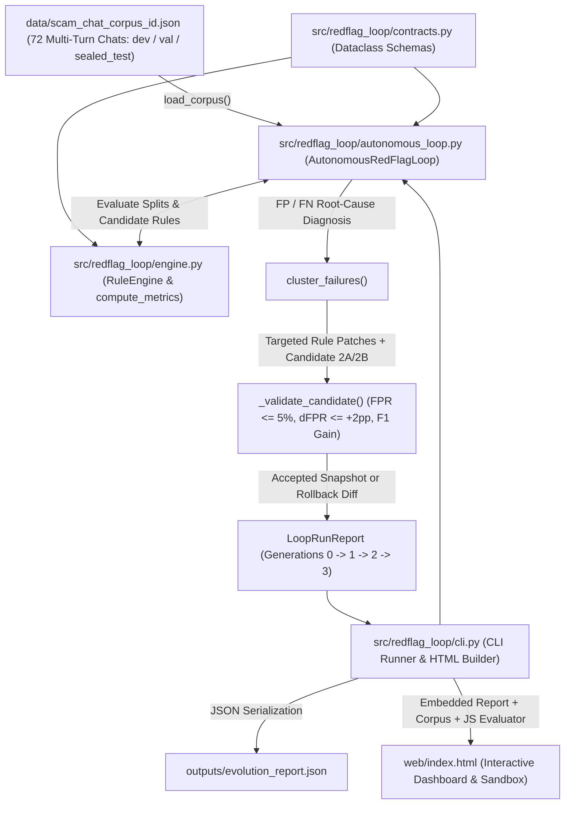

# RedFlag Loop Architecture

## 1. System Overview

**RedFlag Loop** (`redflag_loop`) is a zero-dependency, deterministic **Write → Run → Evaluate → Repair** rule-evolution engine for Indonesian marketplace chat trust & safety. It autonomously diagnoses False Positive (`FP`) and False Negative (`FN`) clusters across labeled Bahasa Indonesia buyer/seller/impersonator conversations (`ID-ScamChat-72`), synthesizes context-aware regex, token-proximity, domain-TLD, and negative-whitelist rule patches, enforces validation split guardrails with automatic rollback of over-broad candidates, and exports both a structured JSON evolution ledger and a self-contained interactive dark-mode HTML sandbox.

---

## 2. System Context & Data Flow



---

## 3. Autonomous Evolution Pipeline (`Gen 0 → Gen 3`)

```mermaid
sequenceDiagram
  participant CLI as "cli.py (main)"
  participant LOOP as "AutonomousRedFlagLoop"
  participant ENG as "RuleEngine (engine.py)"
  participant VAL as "_validate_candidate (Guardrail)"
  participant OUT as "Artifacts (JSON + HTML)"

  CLI->>LOOP: AutonomousRedFlagLoop(corpus_path).run()
  LOOP->>ENG: Gen 0 Baseline Rules -> evaluate_corpus(full, val, sealed_test)
  ENG-->>LOOP: Gen 0 Metrics (F1=0.629, FPR=50.0%) + FP/FN Clusters

  LOOP->>LOOP: _apply_generation_1_patches() (Courier/Refund Whitelist + Sideload APK/QRIS)
  LOOP->>ENG: evaluate_corpus(val_samples)
  LOOP->>VAL: Check FPR <= 5.0%, dFPR <= +2.0pp, Val F1 > Prev Val F1
  VAL-->>LOOP: ACCEPTED -> Promote Gen 1 Rules (F1=0.824, FPR=0.0%)

  LOOP->>LOOP: _build_overbroad_gen2_candidate() (Candidate 2A: bare payment keywords)
  LOOP->>ENG: evaluate_corpus(val_samples)
  LOOP->>VAL: Check Candidate 2A against Guardrails
  VAL-->>LOOP: REJECTED_GUARDRAIL (Val FPR > 5.0%) -> Automatic Rollback!

  LOOP->>LOOP: _apply_generation_2_patches() (Candidate 2B: Leetspeak Phone + Typosquat/OTP)
  LOOP->>ENG: evaluate_corpus(val_samples)
  LOOP->>VAL: Check Candidate 2B against Guardrails
  VAL-->>LOOP: ACCEPTED -> Promote Gen 2 Rules (F1=0.936, FPR=0.0%)

  LOOP->>LOOP: _apply_generation_3_patches() (Bracketed Fake CS Headers + Freeze Countdowns)
  LOOP->>ENG: evaluate_corpus(val_samples)
  LOOP->>VAL: Check Gen 3 Candidate against Guardrails
  VAL-->>LOOP: ACCEPTED -> Converged Gen 3 Rules (F1=1.000, FPR=0.0%)

  LOOP-->>CLI: LoopRunReport (converged=True, generations=4)
  CLI->>OUT: Write outputs/evolution_report.json & web/index.html
```

---

## 4. Module Breakdown

| Module / Path | Primary Responsibility |
| :--- | :--- |
| `src/redflag_loop/__init__.py` | Public package surface exporting `AutonomousRedFlagLoop`, `RuleEngine`, `compute_metrics`, `load_corpus`, `get_generation_0_rules`, and all 9 typed data contracts. |
| `src/redflag_loop/contracts.py` | Memory-compact `@dataclass(slots=True)` domain models (`ChatTurn`, `ChatSample`, `DetectionRule`, `RedFlagSpan`, `SampleEvaluation`, `EvalMetrics`, `FailureCase`, `PatchDiff`, `GenerationSnapshot`, `LoopRunReport`) with deterministic rounded `to_dict()` serializers. |
| `src/redflag_loop/engine.py` | Deterministic `RuleEngine` evaluating multi-turn chat text across four primitives: (1) negative-context / whitelist suppression (`negative_patterns`), (2) case-insensitive regexes (`patterns`), (3) character-window token co-occurrence (`proximity_pairs`), and (4) suspicious TLD URL matching (`suspicious_tlds`). Maps cumulative rule weight to `BLOCK` ($\ge 0.50$), `REVIEW` ($\ge 0.25$), or `ALLOW` ($< 0.25$), and computes split-level `EvalMetrics` in `compute_metrics()`. |
| `src/redflag_loop/autonomous_loop.py` | Baseline naive rules (`get_generation_0_rules`), automated FP-by-rule and FN-by-category root-cause clustering (`cluster_failures`), multi-generation candidate synthesis (`Gen 1`, over-broad `Candidate 2A`, precision-safe `Candidate 2B`, `Gen 3`), and validation guardrail enforcement (`_validate_candidate`). |
| `src/redflag_loop/cli.py` | Command-line runner (`redflag-loop` console script) and `build_dashboard_html()`, which compiles `LoopRunReport` and `ID-ScamChat-72` into a zero-network dark-mode HTML application (`web/index.html`) with SVG progression charts, patch/rollback diff tabs, and a real-time Gen 3 vs Gen 0 chat sandbox. |
| `data/scam_chat_corpus_id.json` | Curated 72-sample multi-turn Bahasa Indonesia marketplace benchmark spanning 6 categories (`benign_negotiation`, `phishing_link`, `fake_courier_apk`, `qris_refund_trap`, `off_platform_escrow_bypass`, `fake_cs_urgency`) partitioned into `dev`, `val`, and held-out `sealed_test` splits. |

---

## 5. State Management, Persistence, Concurrency & Guardrail Safety

- **Immutable Candidate Transitions:** Every generation deep-copies the active rule list (`copy.deepcopy(current_rules)`) before applying candidate mutations. Rejected candidates (such as `Candidate 2A` in Generation 2) are recorded in `GenerationSnapshot.rejected_patches` without mutating `current_rules` or advancing `prev_val_metrics`.
- **Three-Gate Validation Guardrail (`_validate_candidate`):** A synthesized patch is promoted if and only if on `val_samples`:
  1. `candidate_val_metrics.false_positive_rate <= max_fpr_guardrail` (default `5.0%`),
  2. `candidate_val_metrics.false_positive_rate - prev_val_metrics.false_positive_rate <= max_fpr_increase` (default `+2.0` percentage points), and
  3. `candidate_val_metrics.f1 > prev_val_metrics.f1` (strict validation F1 improvement).
- **Explainable Evidence Spans & Suppression Accounting:** When a rule matches both positive evidence (`rule_spans`) and a `negative_patterns` whitelist (e.g., an alphanumeric J&T/JNE tracking number without `.apk` coercion, or an official `Pusat Resolusi` instruction), `RuleEngine` withholds the rule's weight from `risk_score` and logs its ID in `SampleEvaluation.suppressed_rules` for analyst auditability.
- **Stateless Execution & Zero External I/O:** The engine is pure Python (`dependencies = []` in `pyproject.toml`), single-process deterministic, and performs no network requests. Persistence consists solely of atomic UTF-8 file writes to `outputs/evolution_report.json` and `web/index.html`.

---

## 6. Local Verification & Test Commands

`pyproject.toml` configures `pythonpath = ["src"]` and `testpaths = ["tests"]`. Run the test suite locally with zero network activity:

```powershell
Set-Location C:\Users\ardhy\Projects\redflag-loop
C:\Python314\python.exe -m pytest -q
```

Regenerate the report and dashboard into temporary or default local paths:

```powershell
$env:PYTHONPATH = "src"
C:\Python314\python.exe -m redflag_loop.cli --report-out outputs\evolution_report.json --dashboard-out web\index.html
```
