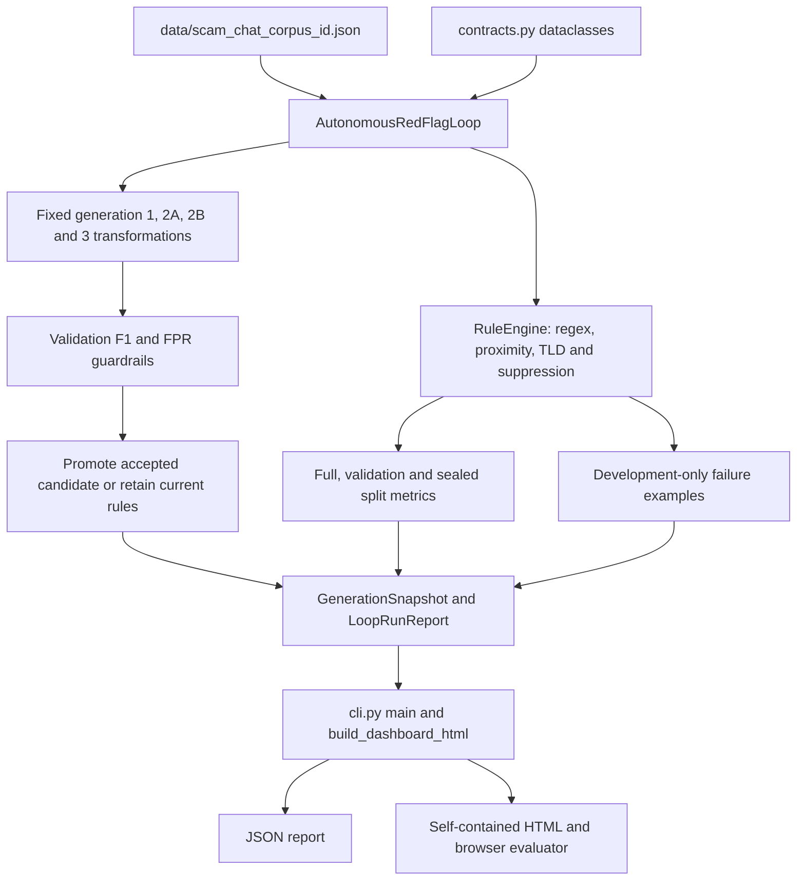
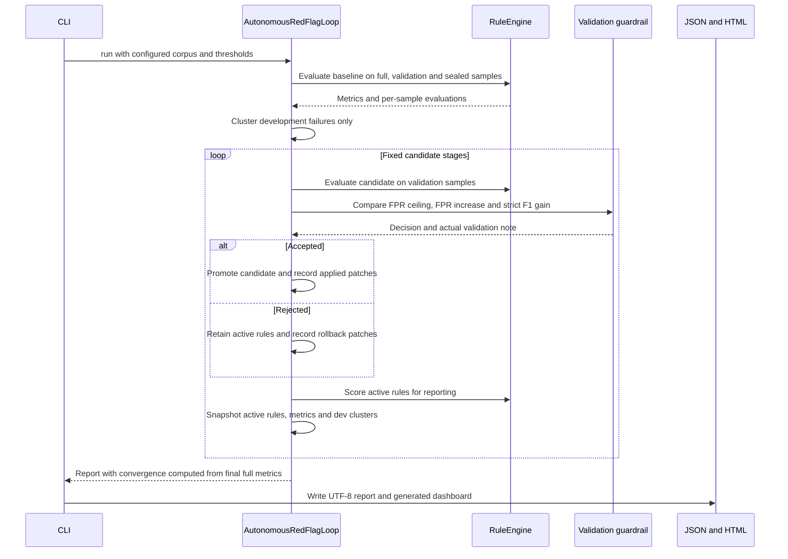

# RedFlag Loop architecture

Source crosscheck: 2026-11-08 WIB. This deterministic Python demonstration evaluates fixed candidate rule transformations against a small labeled Indonesian marketplace-chat corpus. The transformations are hand-written in autonomous_loop.py. It does not call an LLM or learn arbitrary rules from cluster contents.

## System context and data flow



## Execution sequence



## Modules and state

src/redflag_loop/contracts.py defines the chat, rule, span, evaluation, metric, patch, generation and run dataclasses. Serializers turn these into report dictionaries. src/redflag_loop/engine.py loads corpus JSON, evaluates weighted rules, deduplicates same-rule span ranges and computes metrics. A rule contributes its weight once when positive evidence exists without negative-context suppression. Default decision thresholds are 0.50 for BLOCK and 0.25 for REVIEW.

src/redflag_loop/autonomous_loop.py owns baseline definitions, failure grouping, fixed candidate transformations and orchestration. Each transformation deep-copies candidate rules. Only an accepted validation result updates current_rules and prev_val_metrics. _record_patch_decision assigns actual accepted/rejected provenance to candidate diffs. The explicitly overbroad generation-2A candidate is an adversarial demonstration that is not promoted in its branch. Current failure clusters draw examples from self.dev_samples, while validation and sealed samples still receive separate scoring for reporting.

src/redflag_loop/cli.py contains the local CLI and the generated HTML application. _safe_script_json escapes script-significant characters before embedding JSON. HTML metadata renderers use escapeHtml. The generated browser evaluator implements regex and proximity primitives, but currently omits suspicious_tlds, so it is not a complete Python-engine equivalent. There is no persistent service, database or concurrent background worker. File persistence uses Path.write_text, not atomic rename-based transactions.

## Local verification and current limits

```powershell
Set-Location .
C:\Python314\python.exe -m pytest -q
```

tests/test_report_integrity.py exercises rejected-candidate provenance, development-only examples, rejected-run dashboard messaging and metadata escaping using the generated JavaScript. The first crosscheck run exposed four failures. Production source then changed outside this documentation task. Current source contains corresponding corrections, and a fresh test rerun is required to establish their execution status. No historical default-corpus F1 value is a guarantee for a different corpus. Convergence currently uses final full-corpus F1/FPR, not validation-only success. There is no production fraud-detection or live marketplace validation claim.
